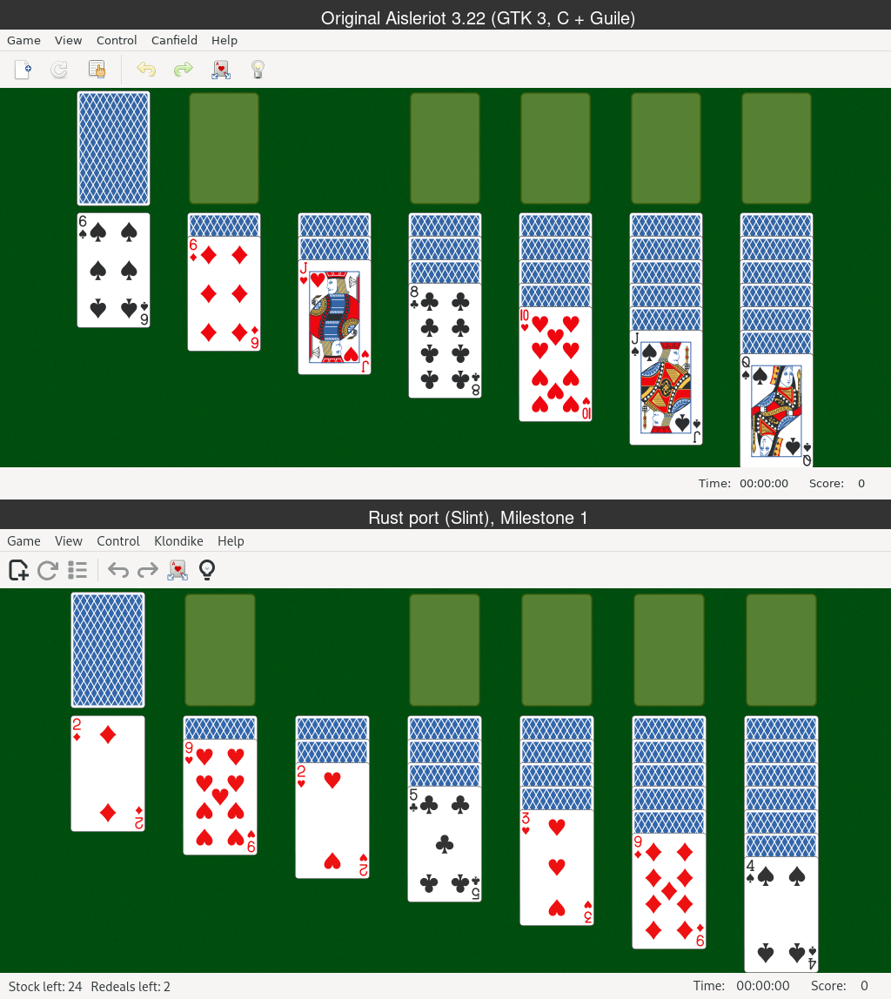
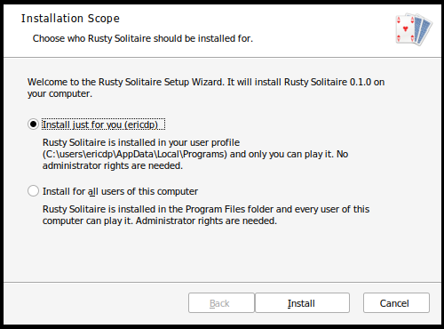

# Rusty Solitaire

A cross-platform Rust rewrite of [GNOME Aisleriot Solitaire](https://gitlab.gnome.org/GNOME/aisleriot)
that looks like the GTK 3 original on Linux, Windows and macOS. The UI uses
[Slint](https://slint.dev); cards are drawn from Aisleriot's own SVG card themes with
[resvg](https://github.com/linebender/resvg).



## Status

| Done | Not yet |
|---|---|
| **All 91 Aisleriot games** (Game → Select Game…), with their rule options, hints and autoplay | Sounds (the files are already in `assets/sounds`) |
| Card table ported from `board-noclutter.c`: layout, fanning, drag & drop, drop highlight, right-click reveal, double-click, click-to-move | Statistics |
| Touch screens: tap, double-tap, drag with a finger, long-press to see a covered card | |
| Undo / redo, restart with the same deal, game-over dialogs, Recently Played | Help pages, keyboard navigation on the board |
| GTK 3 / Adwaita menu bar, menus, toolbar and status bar | Notarized macOS / code-signed Windows builds |
| All 26 card themes (View → Card Style), saved settings | |
| Packages: Windows MSI (x64, ARM64), Linux Flatpak, .deb and .rpm (x86_64, ARM64), macOS universal .dmg | |

## Versions

The version is set in one place, `Cargo.toml`; the packages, the About box, the Windows
file details and the macOS bundle all take it from there. Every bug fix or improvement
raises the minor version (0.1.0 → 0.2.0 → 0.3.0 …) and gets an entry in
[CHANGELOG.md](CHANGELOG.md) and a `<release>` in
`packaging/linux/io.github.rustysolitaire.RustySolitaire.metainfo.xml` (the Flatpak build checks this).

## Build and run

All commands in this file are run from this `app/` folder. Install Rust from
<https://rustup.rs>, then:

```bash
cargo run --release
```

```bash
cargo test
```

On Linux you also need a C compiler plus the fontconfig and xkbcommon development
packages. On Fedora: `sudo dnf install gcc fontconfig-devel libxkbcommon-devel`.

## macOS (universal: Apple Silicon and Intel)

```bash
packaging/macos/build-mac.sh [user@mac]
```

builds `dist/Rusty-Solitaire-<version>-macos-universal.dmg` on a Mac over SSH (default
host: `$MAC_HOST`, else `MAC_HOST=user@mac` in `packaging/macos/local.env`, which is not
committed). The Mac needs Remote Login with this
machine's SSH key, Apple's command-line tools (`xcode-select --install`) and Rust. The
script copies the source to `~/rusty-solitaire-build` on the Mac, builds both chip types,
joins them with `lipo`, makes `Rusty Solitaire.app` (icon, version, copyright), signs it
ad hoc and wraps it in a drag-to-Applications disk image, which it copies back.

The app is signed but not notarized, so the first time macOS blocks it: right-click the
app → **Open** (or System Settings → Privacy & Security → **Open Anyway**). An Apple
Developer ID would remove that step.

## Linux: .deb and .rpm packages (x86_64 and ARM64)

```bash
packaging/linux/build-packages.sh
```

builds, in `dist/`:

| File | For |
|---|---|
| `rusty-solitaire_<version>-1_amd64.deb` / `_arm64.deb` | Debian 12+, Ubuntu 22.04+, Linux Mint, … |
| `rusty-solitaire-<version>-1.x86_64.rpm` / `.aarch64.rpm` | Fedora 36+, openSUSE Tumbleweed, RHEL 10, … |

Install with `sudo apt install ./rusty-solitaire_…deb` or `sudo dnf install ./rusty-solitaire-…rpm`;
the package manager pulls in the few libraries it needs. Both add **Rusty Solitaire** to the
applications menu and a `man rusty-solitaire` page. The program goes in `/usr/games` (Debian
convention) or `/usr/bin` (Fedora). Needs `dpkg-deb` and `rpmbuild`
(`apt install rpm`); the ARM64 packages also need the ARM64 cross-compiler (see Flatpak below).
The RPMs aren't GPG-signed, so `rpm -K` reports them as unsigned.

## Linux: Flatpak (x86_64 and ARM64)

```bash
packaging/flatpak/build-flatpak.sh
```

builds `dist/Rusty-Solitaire-<version>-x86_64.flatpak` and `-aarch64.flatpak` (Linux on
ARM64: Raspberry Pi 4/5 with a 64-bit OS, ARM laptops, …). Pass `x86_64` or `aarch64` to
build one. It needs `flatpak`; the ARM64 build also needs
`rustup target add aarch64-unknown-linux-gnu` and `apt install gcc-aarch64-linux-gnu`.
The runtimes don't have to be installed to build the bundles. Install one with

```bash
flatpak install --user Rusty-Solitaire-<version>-x86_64.flatpak
```

which adds **Rusty Solitaire** to the applications menu (app ID `io.github.rustysolitaire.RustySolitaire`).
Flatpak downloads the Freedesktop 26.08 runtime from Flathub if it is missing. The app runs
sandboxed with access only to its window and the GPU; its settings live in
`~/.var/app/io.github.rustysolitaire.RustySolitaire`.

Without Flatpak, `cargo build --release --target aarch64-unknown-linux-gnu` gives a plain
ARM64 program that needs only glibc 2.39 or newer.

## Windows installers (x64 and ARM64)

```bash
installer/build-msi.sh
```

builds, in `dist/`, an installer and a standalone program for each Windows architecture:

| File | For |
|---|---|
| `Rusty-Solitaire-<version>-x64.msi` / `.exe` | Intel and AMD PCs |
| `Rusty-Solitaire-<version>-arm64.msi` / `.exe` | Windows on ARM (Snapdragon, Surface Pro X, …), native |

Pass `x64` or `arm64` to build just one. It needs [wixl](https://wiki.gnome.org/msitools)
(`apt install wixl`), plus:

- x64: `rustup target add x86_64-pc-windows-gnu` and `apt install mingw-w64`
- ARM64: `rustup target add aarch64-pc-windows-gnullvm` and
  [llvm-mingw](https://github.com/mstorsjo/llvm-mingw) unpacked in `~/.local/opt`
  (or pointed to by `$LLVM_MINGW`)

The first page of the setup wizard asks who to install for:

- **Just for you:** into `%LocalAppData%\Programs\Rusty Solitaire`, Start menu entry for
  that user only, no administrator rights needed.
- **All users:** into `C:\Program Files\Rusty Solitaire`, Start menu entry for everyone;
  Windows asks for administrator rights.



Silent installs: `msiexec /i Rusty-Solitaire-<version>-x64.msi /qn` (or the `-arm64.msi`) installs just for the
current user; add `MSIINSTALLPERUSER=""` for all users (run from an elevated prompt).

## Diagnosing input problems

Tick **Help → Record Input Log** (or start the program with `--log-input`) to record every
press, move and release (mouse or finger) and every menu action, with timings, in
`input-log.txt` next to the settings file:
`%APPDATA%\rusty-solitaire` on Windows, `~/.config/rusty-solitaire` on Linux,
`~/Library/Application Support/rusty-solitaire` on macOS.

## Layout

| Path | What it is | Ported from |
|---|---|---|
| `assets/games/*.scm` | The original game rules, unchanged | `games/*.scm` |
| `src/scheme/` | A small Scheme interpreter that runs those rule files | Guile |
| `src/rules.rs` | The bridge between the rule files and the table | `game.c` (Scheme interface) |
| `src/game.rs` | Table, undo/redo, game state and clock | `game.c` |
| `src/board.rs` | Card table geometry, input, painting | `board-noclutter.c` |
| `src/theme.rs` | SVG card themes | `ar-card-theme-svg.c` |
| `src/card.rs` | Cards and the deterministic shuffle | `ar-card.c` |
| `src/main.rs` | Window, menus, dialogs, game chooser | `window.c`, `ar-game-chooser.c` |
| `ui/app.slint` | The GTK 3 look | GTK 3 Adwaita theme |

The games run on the original Aisleriot rule files, so they behave exactly like the
original. `cargo test` plays every game with random moves to check that the rule code
never fails and never duplicates a card. To add a game, drop its `.scm` file into
`assets/games/`.

## License

GPL-3.0-or-later, like the original. Card themes, artwork, fonts and icons keep their
own licenses; see `assets/cards/README.*` and `assets/licenses/`.
